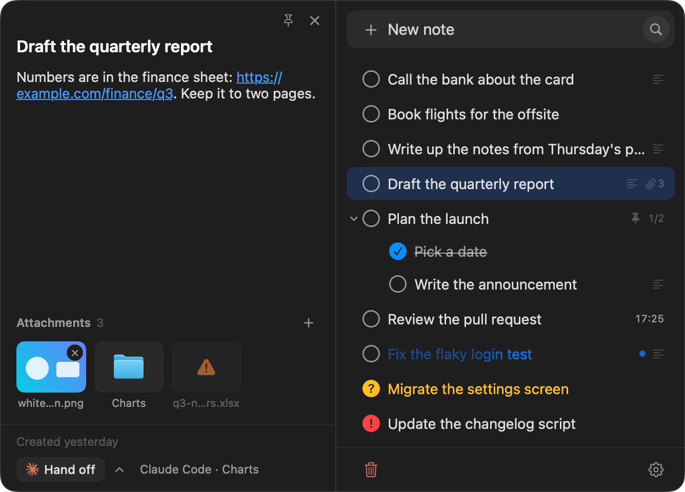
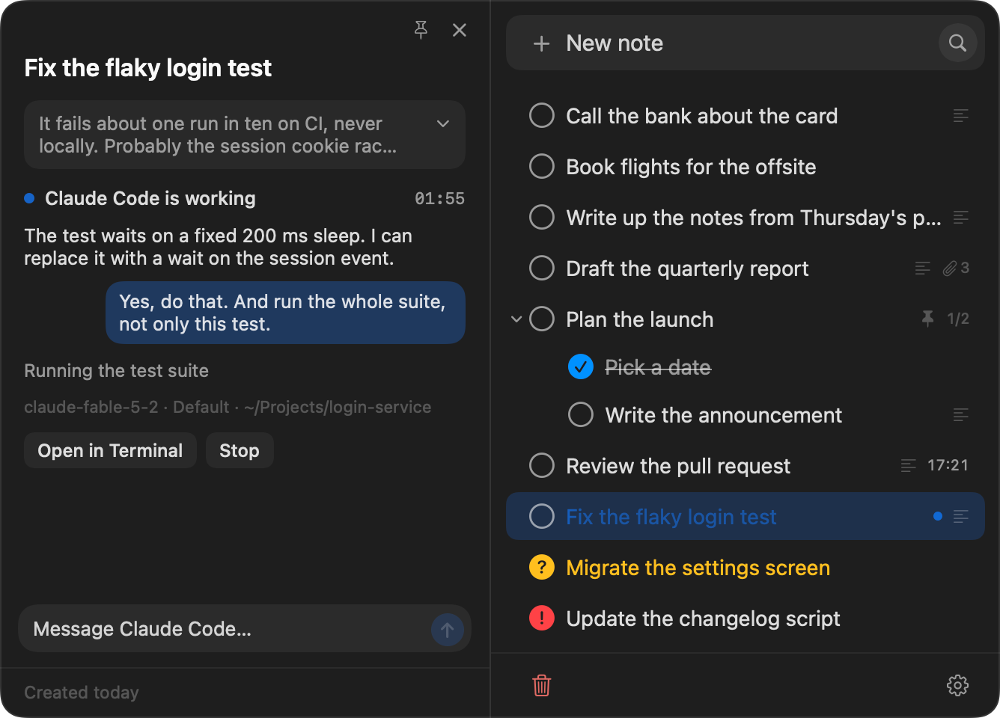

# Bunny

Quick notes in your Mac's menu bar, with one-click hand-off to Claude Code or Codex.

<p align="center">
  
</p>

## Install

Requires macOS 26 or later.

1. Download `Bunny.dmg` from the [latest release](https://github.com/NikhilTirunagiri/bunny/releases/latest).
2. Open it and drag Bunny to Applications.
3. Open Bunny once. macOS blocks it, because the app is not notarized.
4. Go to System Settings → Privacy & Security, scroll down, and click **Open Anyway**. Open Bunny again and confirm.

Or skip steps 3 and 4 with one command:

```sh
xattr -dr com.apple.quarantine /Applications/Bunny.app
```

Bunny is signed ad hoc and not notarized: notarization needs a paid Apple developer account, and we do not have one. On current macOS, right-click → Open no longer gets past this; use one of the two ways above.

Bunny lives in the menu bar. Click the icon to open it; right-click for Settings and Quit.

## What it does

- A list of notes with subtasks. Ticked notes drop into a Completed group.
- Each note has details (links are clickable) and attachments: files, folders and images, added by paste, drag or the + button.
- Search, Undo, multi-selection and a keyboard shortcut for every common action.
- Trash instead of delete. Completed notes move there after 24 hours and Trash empties after 30 days; both are settings.
- A timer per note. A running timer shows in the menu bar with its note.
- Optional hand-off of a note to Claude Code or Codex. The agent's replies and questions show in the note, and you can message it from there.
- Everything stays on your Mac. No account, no sync.

## Agents



Agents are off by default. Turn one on in Settings → Agents, or on the second page of the Welcome guide.

- You need the `claude` and/or `codex` command-line tool installed and signed in. Bunny finds them by itself; you can set a path under Advanced.
- **Hand off** sends the note's title, details, subtasks and attachments. Its arrow opens the options: folder, agent, model, effort.
- By default the agent asks before running commands. "Autonomous" is an opt-in under Advanced.
- The agent never works in your home folder. It uses the folder you pick, else a folder attached to the note, else Bunny's own empty folder.
- **Open in …** shows the full session in Terminal (the default), VS Code, the Claude or Codex app, or another app you choose.
- Bunny tools, a local server that lets agents read and create notes, is also off by default.

<br clear="right">

## Keyboard

| Key | Action |
|---|---|
| ⌘N | New note |
| ⌘F | Search |
| ↑ / ↓ | Move the selection |
| Return | Open the selected note |
| Space | Tick or untick |
| ⌫ | Move to Trash (in Trash: delete forever) |
| ⌥↑ / ⌥↓ | Move the note up or down |
| ⌘A | Select all |
| ⌘C | Copy the selected notes as a prompt |
| ⌘V | Attach the copied file or image to the open note |
| ⌘Z | Undo |
| Esc | Back out one step: end editing, leave search, close the note, close the window |
| ⌘, | Settings |
| ⌘Q | Quit |
| Global shortcut | Open Bunny from any app, ready for a new note. Not set until you choose one in Settings → General. |

The list keys work while no text field has focus.

## Your data

- Notes and attachments are stored in `~/Library/Application Support/Bunny/`.
- Settings → Data has **Export all notes** (Markdown files plus attachments), **Empty Trash**, **Reset settings** and **Erase all data**.
- Upgrading from v1.0 or v2.0.0 keeps your notes. Notes that were in the Archive move to Trash. Before the first v3 launch touches the database, a copy is saved to `~/Library/Application Support/Bunny/Backups/pre-v3/`.

## Build from source

Needs Xcode 26 or later. There are no dependencies.

```sh
xcodebuild -project bunny.xcodeproj -scheme bunny -configuration Debug -derivedDataPath .build/dd CODE_SIGN_IDENTITY=- build
swift test
```

`swift test` runs the unit tests of the pure logic in `bunny/Core`. A Debug build can render its own UI states to PNG files, with sample notes and without showing a window: `.build/dd/Build/Products/Debug/bunny.app/Contents/MacOS/bunny --snapshot <dir>`.

## Releasing

`scripts/release.sh` tests, builds and packs `dist/Bunny.dmg`; with `--publish` it also tags and creates the GitHub release from `docs/releases/v<version>.md`.

## Credits

By Nikhil Tirunagiri and Rahul Sharma.

MIT licensed. See [LICENSE](LICENSE).
